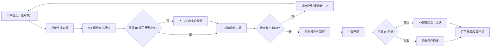

# 04 B1.1 参考答案与思考路径｜餐饮行业智能点餐系统

> 考核时间 25min｜交付：`参赛号/B1.1/答题卷.doc` + 平台最终提交  
> **思考路径比答案更重要**：看见痛点关键词 → 映射技术模块 → 人机兜底 → 可量化指标。

---

## 思考路径（上场前默念）

| 题面关键词 | 决策 | 为何这样答 | 如何自学巩固 |
|---|---|---|---|
| 特殊备注「少冰/去葱」 | NLP 槽位抽取 + 置信度 + 人工校对 | 备注是自然语言，纯规则易漏，必须有人机回路 | 练意图识别+槽位；画菱形判断 |
| 营销转化/复购低 | 推荐 + 优惠匹配 + 用户画像 | 痛点一对应「个性化」而非只做下单通道 | 学协同过滤/召回-排序；写转化率公式 |
| 高峰拥堵 | 限流、排队预估、多轮澄清、产能感知 | 体验差来自等待与错单，不只是算力 | 学排队论直觉：产能、队列、SLA |
| 门店接单/出餐延迟 | 智能调度、制作队列、库存校验 | 系统必须对接后厨与配送，不能停在 App | 画泳道到配送员；写准时率 |
| 数据字段给出 | 用字段设计输入输出接口 | 评委看你是否用题面数据 | 每题先列「已有字段→还缺字段」 |

---

# 答题卷正文（可誊抄）

## 任务一：业务框架设计

### 1. 总体四层框架

| 层级 | 模块 | 说明 |
|---|---|---|
| 输入层 | 菜单/库存、用户偏好、订单与备注、门店产能、配送状态 | 对接 POS/库存、会员、订单中台 |
| AI 能力层 | 备注 NLP 解析、个性化推荐与优惠匹配、需求预测、智能派单与厨房调度 | 置信度门控；低置信转人工 |
| 业务协同层 | 下单、人工校对、后厨制作、出餐、自取/配送、异常回退 | 人机职责清晰 |
| 输出层 | 结构化备注工单、推荐结果、制作队列、预估出餐时间、告警与报表 | 可写入 POS/KDS/配送系统 |

### 2. 核心技术模块

1. **备注解析引擎**：意图识别 + 槽位抽取（商品、口味、禁忌、份量）；同义词/错别字归一。
2. **推荐与优惠引擎**：基于历史订单与时段的召回-排序；优惠券/套餐智能匹配。
3. **高峰流量与产能调度**：按门店产能、库存、配送半径动态限流与分单。
4. **厨房制作队列优化**：按出餐耗时、设备占用、备注复杂度排程。
5. **人机协同工作台**：低置信备注高亮、一键确认/修改、操作日志。

### 3. 系统与门店人员协作机制

| 角色 | 系统自动做 | 人员必须做 |
|---|---|---|
| 智能系统 | 解析备注、推荐、生成队列、预估时长、推送 | — |
| 人工接单员 | 接收低置信/冲突订单 | 校对备注、确认库存、必要时电话澄清 |
| 后厨 | 接收结构化工单与排队 | 按工单制作、扫码完成、反馈异常 |
| 配送员 | 接收路径与时效 | 取餐送达、异常上报 |

**原则**：高置信全自动；低置信或库存冲突必须人工确认后才能进后厨。

### 4. 数据输入 / 输出接口设计

**输入接口（示例）**

- `POST /api/order/create`：订单编号、用户编号、门店编号、商品明细、特殊备注原文、下单时间
- `GET /api/store/{id}/capacity`：门店当前产能、排队长度、设备状态
- `GET /api/inventory/{store_id}`：SKU 库存
- `GET /api/user/{id}/profile`：偏好与历史订单摘要

**输出接口（示例）**

- `POST /api/kds/ticket`：结构化备注（商品×属性）、制作优先级、预估出餐分钟数
- `POST /api/recommend/result`：推荐商品/优惠及理由
- `POST /api/dispatch/assign`：配送员与 ETA
- `POST /api/alert`：超时、错单、库存不足告警
- 日志：订单状态流转、人工修改前后对比、模型版本号

---

## 任务二：业务流程设计

### 1. 人机协同完整流程（文字版，考场用 WPS 画泳道）

**泳道**：用户｜智能点餐系统｜人工接单员｜后厨｜配送员

**关键节点说明**

1. 用户浏览菜单、选品、填写备注（如「拿铁少冰，汉堡不要洋葱」）。
2. 系统落单并调用 NLP：抽取商品、属性（少冰）、禁忌（去葱/不要洋葱）。
3. **判断**：置信度 ≥ 阈值（建议方案值 0.85）且与菜单/库存无冲突 → 自动通过；否则进人工。
4. 人工接单员校对或发起多轮澄清，确认后写回结构化字段。
5. 库存/产能检查；不足则换品、排队延后或推荐邻近门店。
6. 工单进入厨房显示屏（KDS），按优先级制作。
7. 出餐完成：自取推送取餐码；配送则智能派单。
8. 用户反馈与错单标签回流，用于标注与模型迭代。

### 2. 数据层面优化方案

| 措施 | 内容 | 指标 |
|---|---|---|
| 数据字典与标准词表 | 「少冰/少氷/少冰块」归一；禁忌词表 | 词表覆盖率 ≥ 95% |
| 标注与质检 | 备注→结构化槽位双人标注+抽检 | 标注一致率 ≥ 95% |
| 质量治理 | 错别字、空备注、矛盾备注清洗 | 脏数据率 ≤ 2% |
| 特征与反馈闭环 | 错单原因码、人工修改日志回流训练集 | 周级增量训练 |
| 关联题面字段 | 用出餐耗时、订单状态分析瓶颈门店/时段 | 高峰出餐 P95 下降 |

### 3. 模型层面优化方案

| 措施 | 内容 | 指标 |
|---|---|---|
| 备注模型 | 意图分类 + 槽位抽取（可用规则+小模型） | 槽位 F1 ≥ 0.90 |
| 置信度门控 | 低于阈值转人工，避免静默错单 | 自动通过准确率 ≥ 98% |
| 推荐模型 | 召回（协同/热门）+ 排序（时段/门店） | 点击率/转化率 A/B 提升 |
| 需求预测与调度 | 按时段预测单量，驱动备料与排队 | 预测 MAPE ≤ 15% |
| 线上监控 | 错单率、备注相关投诉、出餐超时率 | 日报告警 |

---

## 任务三：业务流程优化（对准三大痛点）

### 1. 高峰期流量调度方案

- **门店级限流与排队预估**：根据实时产能与历史出餐耗时，展示「预计等待 X 分钟」；超阈值暂停接新单或引导错峰优惠。
- **动态分单**：同城多门店按距离、库存、队列长度分配。
- **备注复杂度加权**：含多禁忌的订单增加制作缓冲，避免高峰错单。
- **指标**：高峰时段平均等待时长、出餐超时率、备注相关错单率。

### 2. 多轮点餐优化方案

- **澄清话术模板**：低置信时系统追问「汉堡是不要洋葱还是不要葱花？」
- **结构化点选优先**：口味用选项卡，自由文本作补充，降低 NLP 压力。
- **会话状态机**：选品→备注确认→优惠确认→支付，可回退修改。
- **指标**：多轮澄清成功率、因备注导致的取消率、单均交互轮次。

### 3. 门店协作效率提升方案

- **统一事件/工单**：解析结果一键下发 KDS，禁止口头二次传话。
- **制作队列可视化**：设备占用、备注标签颜色区分。
- **配送协同**：出餐完成自动触发最近运力匹配。
- **指标**：接单到开工时长、平均出餐耗时、配送准时率、门店人效（单/人·时）。

### 营销转化（痛点一，并入优化叙述）

- 首页/结算页个性化推荐与智能满减；复购用户「常点清单」。
- **指标**：下单转化率、复购率、客单价、优惠核销率。

---

## 交卷检查

- [ ] 框架含：核心技术模块、协作机制、输入输出接口  
- [ ] 流程图含：自动解析、人工校对、后厨、配送 + 判断分支  
- [ ] 数据层 + 模型层都写了  
- [ ] 三痛点方案都写了（高峰/多轮/门店）  
- [ ] 有可量化指标  
- [ ] `答题卷.doc` 已存到 `参赛号/B1.1/` 并平台最终提交  
