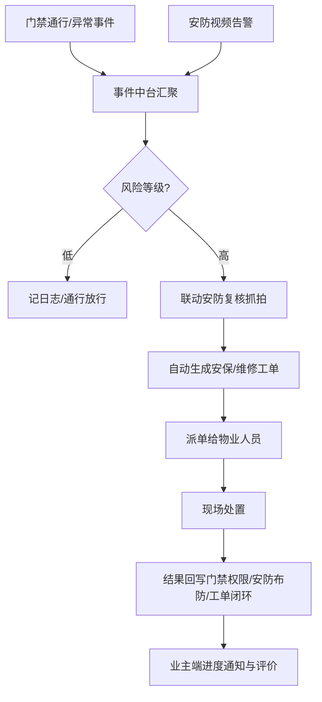
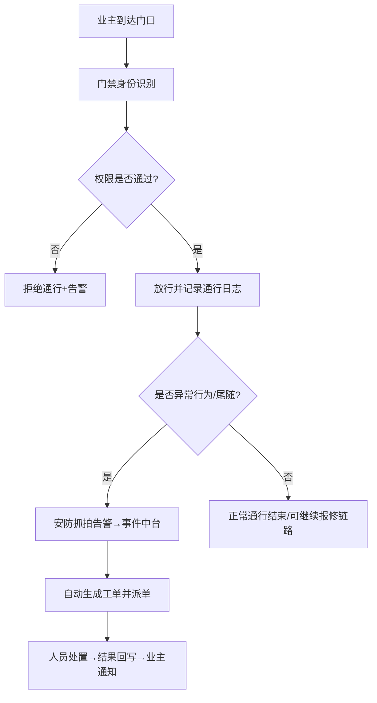

# 07 B3 参考答案与思考路径｜智慧物业全链路智能服务

> 考核时间 35min｜交付：`参赛号/B3/答题卷.doc`  
> 硬性数字：3 产品、3 目标、4 阶段×总 10 周、3 抗拒措施、3 类资源、≥6 节点。

---

## 思考路径

| 看见 | 决策 | 为何 | 巩固 |
|---|---|---|---|
| 三痛点对三产品 | 匹配表一行一产品，技术写具体 | 评委先看对齐 | 人脸/CV/NLP 各对一痛点 |
| 协同 | 事件中台串门禁-安防-工单 | 禁止三张孤岛图 | 统一 ID/事件/日志 |
| 可量化目标 | 时延、召回、闭环时长 | 「更安全」不得分 | 带单位与测量方式 |
| 10 周 4 阶段 | 周期相加必须=10 | 常见丢分点 | 勘察→建设→试点→推广 |
| 抗拒 | 参与+培训+激励 | 变革管理不是骂人 | 试点标杆 |
| ≥6 节点 | 从「业主进小区」起笔 | 题面起点固定 | 正常+异常分支 |

---

# 答题卷正文

## 任务一：（1）《智能产品功能匹配表》

| 智能产品名称 | 解决的具体问题 | 核心功能（需含技术实现） |
|---|---|---|
| 智能门禁系统 | 出入依赖人工值守，效率低、存在尾随/冒用等安全隐患 | 人脸识别/二维码/车牌识别；权限库与访客临时码；活体检测防照片攻击；陌生人/强制开门告警；通行日志入库 |
| 智能安防监控系统 | 监控只能人工回放，无法实时预警 | 视频目标检测与行为分析（周界入侵、徘徊、烟火、跌倒等）；实时告警推送；告警联动自动录像与抓拍；夜视/多路流管理 |
| 智能报修与工单系统 | 报修靠电话/线下，沟通低效、进度不透明 | App/小程序提单；NLP 故障分类与优先级；按技能与位置自动派单；SLA 计时与催办；进度推送与评价回访；知识库辅助维修 |

## 任务一：（2）三产品协同工作流程（文字/Mermaid）

**泳道建议**：门禁｜安防｜事件中台｜工单｜物业人员/业主

**协同要点**：统一人员/房屋/设备主数据；事件 ID 贯穿三系统；处置结果双向回写。

## 任务一：（3）3 个核心目标（可量化｜建议目标值）

1. **通行效率与安全**：高峰门岗平均验证时延 ≤ 2 秒；未授权闯入识别率 ≥ 98%（月度抽检）。
2. **安防实时预警**：高优先级告警从发生到值班端推送 ≤ 5 秒；周界入侵召回率 ≥ 95%。
3. **报修服务闭环**：报修平均首次响应 ≤ 15 分钟；工单闭环时长较上线前下降 ≥ 30%；业主满意度 ≥ 90%。

---

## 任务二：实施推动

### （1）4 阶段实施计划（总周期 10 周）

| 阶段 | 周期 | 关键任务 | 责任人 |
|---|---|---|---|
| 一、需求调研与现场勘察 | 第 1–2 周（2 周） | 痛点访谈、点位勘察、现状流程与接口摸底、成功标准确认 | 项目经理、AI 训练师、物业运营主管 |
| 二、方案细化与资源准备 | 第 3–4 周（2 周） | 详细设计、设备选型采购、主数据治理、规则/模型准备、培训大纲 | 系统架构师、采购、数据工程师 |
| 三、部署集成与试点运行 | 第 5–8 周（4 周） | 安装调试、三系统联调、单楼栋试点、问题清单闭环、指标试运行 | 实施工程师、安保主管、客服主管 |
| 四、验收培训与全面推广 | 第 9–10 周（2 周） | 验收测试、全员培训、制度切换、全小区推广与运维移交 | 项目经理、培训专员、运维负责人 |

> 2+2+4+2=10 周。

### （2）员工抗拒新系统——3 项应对措施

1. **参与式共建**：一线保安/维修早参与需求访谈与界面试用，把痛点写进迭代清单。
2. **分层培训 + 操作手册/短视频**：按岗位 contingency 演练；设「数字辅导员」现场带教。
3. **试点标杆 + 激励反馈**：试点班组公开效率与表扬；设立采纳建议奖；保留过渡期双轨并明确切换日。

### （3）三类资源及到位验证

| 类别 | 具体资源 | 到位验证方式 |
|---|---|---|
| 人力 | 项目经理 1、实施 2、数据/算法 1、门岗与维修关键用户代表、值班坐席 | 任命文件/排班表；培训签到；岗位到岗确认单 |
| 物力 | 摄像头、门禁终端、服务器/边缘盒、网络交换机、业主端小程序 | 到货验收单、序列号台账、联通性测试报告 |
| 财力 | 软硬件采购预算、实施服务费、培训与运维备用金 | 预算批复单、合同与付款节点回单、费用执行表 |

---

## 任务三：全链路流程设计

### （1）从「业主进小区」起 ≥6 关键节点

1. 业主到达门口，触发门禁识别（人脸/二维码/车牌）。
2. 系统校验权限库（业主/访客/黑名单）。
3. **判断**：权限通过 → 放行并写通行日志；不通过 → 拒绝并告警。
4. 放行后若检测到尾随/强行闯入，安防行为分析实时告警。
5. 事件中台研判风险等级，高风险自动生成安保工单并推送值班。
6. 物业人员到场处置，结果回写；同步通知业主 App。
7. （扩展）业主在小区内报修：NLP 分类 → 自动派单 → 维修 → 验收评价 → 归档分析。

### （2）对比传统流程的优势

| 维度 | 传统 | 全链路智能 | 具体优势 |
|---|---|---|---|
| 操作便捷性 | 登记、打电话、多次转述 | 刷脸/扫码通行；App 一键报修自动派单 | 减少排队与重复沟通，业主与员工操作步骤显著减少 |
| 信息实时性 | 回放才知、进度靠问 | 告警秒级推送；工单状态实时可见 | 异常响应更快，进度透明可追溯，便于审计与考核 |

---

## 交卷检查

- [ ] 匹配表 3 行都有技术实现  
- [ ] 协同图 + 全链路图（≥6 节点）  
- [ ] 3 量化目标；4 阶段=10 周；抗拒 3；资源 3+验证  
- [ ] 便捷性/实时性对比具体  
