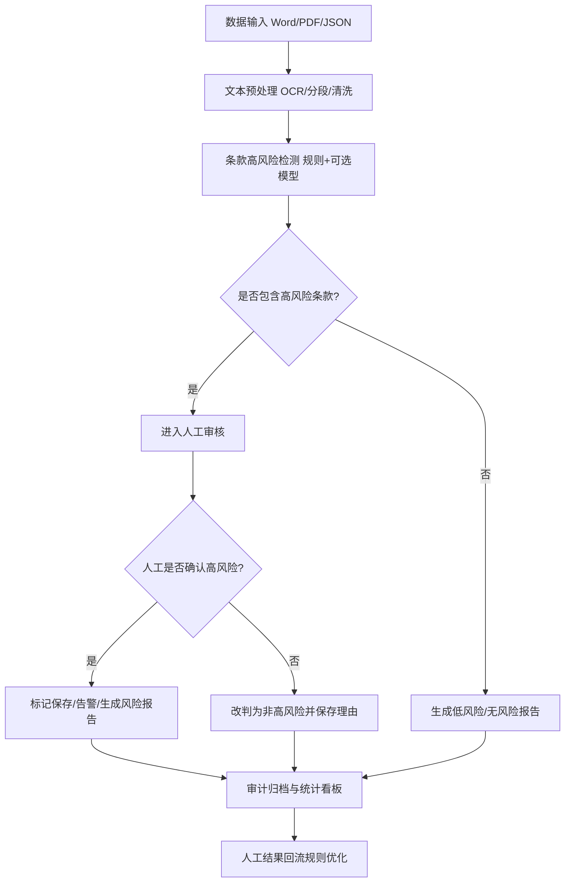

# 09 C 参考答案与思考路径｜法律合同智能审查系统

> 考核时间 30min｜交付：`参赛号/C/答题卷.doc`  
> **核心能力**：把运营诉求写成**可验收**需求（F-XX + 配置能力 + ≥2 量化标准）。

---

## 思考路径

| 看见 | 决策 | 为何 | 巩固 |
|---|---|---|---|
| 三诉求 | 严格一一映射 F-01/02/03 | 题面硬性对应 | 实时检测 / 规则库 / 标记审计 |
| 「必须含配置能力」 | 需求描述写阈值、规则版本、开关 | 不可验收=丢分 | 把形容词改成参数 |
| 五模块流程 | 输入→预处理→检测→人工→报告 | 漏一模块即不合规 | 两菱形判断 |
| JSON | 必有 keyword_list、enable_logging | 题面点名 | 再加 version/risk_type 加分稳 |
| 伪代码 | 识别与标记分开；有持久化与日志 | 实现规划要可编码 | 输入输出写清 |
| 三类测试 | 边界 / 关键词覆盖 / 压力 | 四列：类型目标数据预期 | 用题面 JSON 样例 |

### 需求可验收写法（公式）

```
需求编号：F-XX
需求描述：系统应能【动作】【对象】，并支持【配置项：阈值/开关/版本…】
验收标准：
1）在【条件】下，【指标】【比较符】【数值+单位】（测量方法）
2）对【指定样例/场景】，【可见结果】必须出现
```

**禁止**：「尽量准确」「智能识别大部分风险」。

---

# 答题卷正文

## 任务一：需求转化（3 条）

### 需求编号：F-01

**需求描述**：系统接收 Word/PDF 或结构化 JSON 合同后，应在可配置的时限与规则版本下，对 `clauses[]` 实时识别高风险条款（如免责、提前解除、未经授权付款等），返回命中的 `clause_id`、风险类型、风险等级、命中证据；支持按风险类型配置启用/停用与置信/匹配阈值。

**验收标准**：

1. 对题面示例合同，条款 CL1003（「随时解除…无需承担违约责任」）必须命中「提前解除/免责」类高风险，且 P95 端到端检测响应时间 ≤ 3 秒（以 50 份标准样例压测统计）。  
2. 在规则版本 V 启用且关键词配置完整时，指定高风险样例集召回率 ≥ 98%，误报率 ≤ 5%（以标注集离线评估）。

### 需求编号：F-02

**需求描述**：系统应提供关键字规则库管理功能，管理员可新增、编辑、停用、查询、发布与回滚规则；每条规则至少可配置 `keyword_list`、风险类型、风险等级、生效时间、版本号及 `enable_logging`；发布后对在途检测任务按版本生效策略执行。

**验收标准**：

1. 管理员发布新规则后，≤ 1 分钟内新上传合同按新版本匹配；无权限用户调用管理接口返回 403。  
2. 对任意已发布版本执行回滚，成功率 100%，且审计日志完整记录操作者、前后版本号与时间戳。

### 需求编号：F-03

**需求描述**：系统应对自动命中及人工复核后的条款标记结果进行持久化保存，支持按合同类型、风险类型、时间、相对方、审核状态等维度统计与导出，并提供按 `contract_id + clause_id + rule_version` 的审计追溯；日志字段至少含操作者、时间、动作、规则版本、前后状态、原因。

**验收标准**：

1. 任意已标记条款在 3 秒内可通过审计查询定位到完整证据链，字段完整率 100%。  
2. 统计报表支持至少 4 个维度筛选，导出 1 万条标记记录耗时 ≤ 30 秒且不丢失必填字段。

---

## 任务二：方案设计

### （1）合同审查系统流程图



**关键判断点**：

1. 是否包含高风险条款？  
2. 人工审核是否确认高风险条款？

### （2）关键字规则配置模板（JSON）

```json
{
  "rule_id": "R-001",
  "risk_type": "提前解除权",
  "risk_level": "high",
  "keyword_list": ["随时解除合同", "无需承担违约责任", "单方解除"],
  "enable_logging": true,
  "enabled": true,
  "version": "1.0",
  "effective_from": "2024-01-01T00:00:00Z"
}
```

### （3）统计报表与审计功能设计

**统计维度**：合同类型、风险类型、风险等级、相对方、部门/承办人、时间（日/周/月）、审核状态（待审/确认/驳回）。

**指标**：高风险合同数与占比、各风险类型分布、人工确认率、误报率、平均审核时长、规则命中 TopN。

**审计**：全量操作日志；支持按合同/条款/规则版本追溯；权限分级（审查员/管理员/审计员）；日志只追加不可篡改（或校验和）。

---

## 任务三：实现规划

### （1）识别高风险条款——伪代码

```
function detect_high_risk_clauses(contract, rule_set):
    assert contract has contract_id and clauses
    results = []
    active_rules = load_enabled_rules(rule_set)  # 含 keyword_list, version
    for clause in contract.clauses:
        text = normalize(clause.content)  # 小写/去空白/全半角
        for rule in active_rules:
            hits = match_keywords(text, rule.keyword_list)
            if hits not empty:
                results.append({
                    contract_id: contract.contract_id,
                    clause_id: clause.clause_id,
                    rule_id: rule.rule_id,
                    risk_type: rule.risk_type,
                    risk_level: rule.risk_level,
                    hit_keywords: hits,
                    evidence: snippet(text, hits),
                    rule_version: rule.version
                })
                if rule.enable_logging:
                    write_audit_log(action="detect_hit", ...)
    return results
```

### （2）高风险条款标记——伪代码

```
function mark_high_risk_clause(candidate, review):
    # candidate 来自检测结果；review 含 reviewer_id, decision, reason
    validate_permission(review.reviewer_id)
    validate_state(candidate)  # 防重复标记
    record = {
        **candidate,
        review_decision: review.decision,  # confirmed / rejected
        reviewer_id: review.reviewer_id,
        reviewed_at: now(),
        reason: review.reason
    }
    save_mark_to_db(record)          # 持久化
    update_statistics(record)        # 更新报表聚合
    if rule_logging_enabled(candidate.rule_id):
        write_audit_log(action="mark", before=null, after=record)
    return success(record.id)
```

### （3）功能验证方案

| 测试类型 | 测试目标 | 测试数据示例 | 预期结果 |
|---|---|---|---|
| 边界值测试 | 验证空/极端输入下系统稳定性与明确报错 | ① clauses 为空数组 ② 单条款超长 10 万字 ③ 缺 contract_id ④ 特殊字符/繁简混排 | 不崩溃；缺必备字段返回 4xx 与明确错误码；超长可截断或异步并有提示 |
| 关键词覆盖测试 | 验证命中准确性与误报控制 | ① 精确含「随时解除合同」② 同义改写 ③ 否定语境「不得随时解除」④ 大小写/空格干扰 ⑤ 多关键词同时出现 | 精确与同义按规则命中；否定语境不误报或进人工；多命中去重并保留证据 |
| 压力测试 | 验证并发与批量下的性能与数据不丢 | ① 50 并发上传 ② 批量 1000 份合同 ③ 单份 200 条款 | P95 检测时延 ≤ 约定阈值；错误率 ≤ 1%；标记与审计日志零丢失 |

---

## 交卷检查（硬性）

- [ ] 恰好 3 条需求，映射三诉求；每条 ≥2 量化验收；含配置能力  
- [ ] 五模块 + 两判断  
- [ ] JSON 含 keyword_list、enable_logging  
- [ ] 统计多维度 + 审计字段  
- [ ] 两段伪代码 + 三类测试四列齐全  
