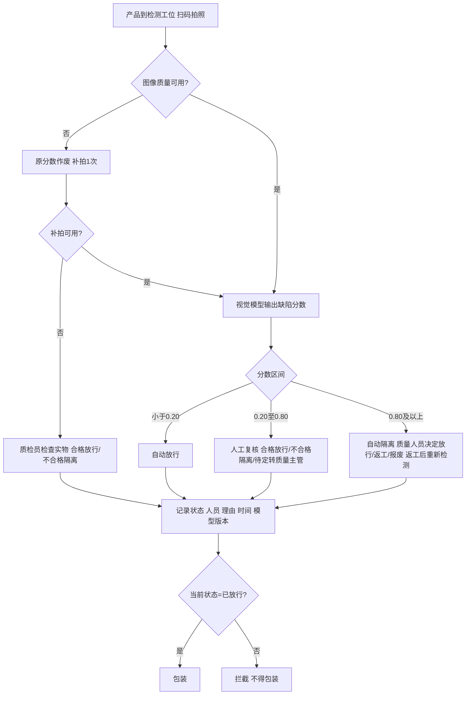

# 2026 B1.1 参考答案｜产品外观智能质检业务框架与流程设计（15 分 · 25min）

> 交付：`参赛号/B1.1/答题卷.doc`（流程图用 Word/WPS 绘图）。

## 思考路径

| 看见题面 | 决策 | 为什么 |
|---|---|---|
| “缺陷分数不是实际缺陷概率，不能替代最终质量结论” | 职责边界写成“模型给分数和建议，人有裁定权” | 评委就看你是否把 AI 当成辅助 |
| 五条业务规则 | 规则表、流程图、P004/P005 路径**逐条复用**这五条 | 规则就是评分点，漏一条扣一块 |
| 问题 3“记录不同步导致不合格品进包装” | 设计“唯一有效状态 + 包装扫码校验” | 这是业务框架里最容易被忽略的模块 |
| 问题 4“人工纠正只记在纸上” | 追溯记录要带**图像 ID + 模型版本 + 人工结论**，回流训练 | 打通模型改进闭环 |
| P004 / P005 | P004 模糊：原分数无效 → 补拍；P005 清晰 0.12：**会被自动放行** | P005 是规则本身拦不住的漏检，引出任务三 |

---

# 答题卷正文

## 任务一：业务框架设计

### 1. 四个必要业务模块及作用

| 模块 | 作用 |
|---|---|
| ① 图像采集与质量检查模块 | 工位相机按产品编号拍照；自动检查模糊、严重反光、主体不完整。不可用则作废原分数、触发补拍一次；补拍仍不可用，生成“实物检查”任务给质检员，**禁止自动放行**。 |
| ② 视觉检测与分流模块 | 对可用图像调用视觉模型，输出缺陷分数和疑似缺陷位置热力图，记录模型版本；按阈值分流：<0.20 自动放行，0.20～0.80 转人工复核，≥0.80 自动隔离。 |
| ③ 人工复核与隔离处置模块 | 质检员在工作台查看图像、热力图和实物，给出合格/不合格/待定；待定转质量主管。质量人员对隔离品按企业标准决定放行、返工或报废；返工品重新进入检测流程。 |
| ④ 质量状态记录与追溯模块（含包装放行控制） | 每件产品维护**唯一当前有效状态**（待检/已放行/隔离/待定/返工/报废），包装工位扫码校验，只有“已放行”才能装箱；人工改判记录人员、理由、时间；人工纠正样本与图像、模型版本关联，进入模型改进数据池。 |

### 2. 系统与质检人员的职责边界

| 角色 | 负责 | 不负责 / 不得 |
|---|---|---|
| 智能质检系统 | 图像质量判定、触发补拍、输出缺陷分数与热力图、按规则分流、推送复核任务、维护状态、包装拦截、统计报表 | 不做最终质量结论；不能自动放行图像不可用产品；不能决定返工或报废 |
| 质检员 | 复核中间分数产品、检查图像不可用产品的实物，**拥有裁定权**；填写复核结论和理由 | 不得把“无法判断”默认为合格 |
| 质量主管 | 处理待定产品，审批改判 | — |
| 质量人员 | 对隔离品决定放行/返工/报废 | 返工品不能直接送包装 |
| 包装工位 | 扫码确认状态为“已放行”后装箱 | 非“已放行”产品不得装箱 |

### 3. 产品追溯输入、输出记录

| 方向 | 来源 / 去向 | 关键字段 |
|---|---|---|
| 输入 | 生产现场 / MES → 系统 | 产品编号、批次号、产线工位、生产时间 |
| 输入 | 工位相机 → 系统 | 图像 ID、拍摄时间、图像质量标记（清晰/模糊/反光/不完整）、补拍次数 |
| 输入 | 视觉模型 → 系统 | 缺陷分数、疑似缺陷位置、模型版本号、推理时间 |
| 输入 | 质检员 / 质量人员 → 系统 | 复核结论、缺陷类型、处置方式（放行/返工/报废）、操作人、理由、时间 |
| 输出 | 系统 → 质检员工作台 | 待复核任务：产品编号、图像、分数、热力图、转人工原因 |
| 输出 | 系统 → 包装工位 | 产品编号、当前有效状态、放行时间、放行依据（自动/人工） |
| 输出 | 系统 → 质量追溯库 | 产品全生命周期状态变更记录（旧状态→新状态、操作人、理由、时间） |
| 输出 | 系统 → 模型训练数据池 | 图像 ID、模型版本、模型分数、人工最终结论、缺陷类型与位置标注 |

## 任务二：业务流程与处置规则设计

### 1. 规则表

| 条件 | 处理动作 | 后续去向 |
|---|---|---|
| **图像不可用**（模糊、严重反光、主体不完整） | 原分数作废，自动补拍 1 次；补拍后仍不可用，生成实物检查任务给质检员，状态“待检” | 补拍可用 → 回到模型检测重新分流；实物检查合格 → 已放行 → 包装；不合格 → 隔离；**不得自动放行** |
| **低分**：图像可用且分数 < 0.20 | 自动放行，状态置“已放行”，记录分数和模型版本 | 包装工位扫码装箱；按 2% 比例随机抽检 |
| **中间分数**：0.20 ≤ 分数 < 0.80 | 推送人工复核任务（附图像、热力图） | 合格 → 已放行 → 包装；不合格 → 隔离；无法判断 → 保持待检，转质量主管，**不得默认合格** |
| **高分**：分数 ≥ 0.80 | 自动隔离，状态置“隔离待处理”，放入隔离区 | 质量人员决定：放行（记录理由）→ 包装；返工 → 返工后重新进入检测；报废 → 报废出库 |

### 2. 业务流程图

### 3. P004、P005 的路径

- **P004**（B02，图像模糊，分数 0.04）：图像不可用 → 原分数 0.04 **无效** → 补拍一次。补拍清晰则按新分数分流；补拍仍不可用 → 质检员检查实物 → 发现划伤 → 判不合格 → 隔离 → 质量人员决定返工或报废。按旧做法直接用 0.04 会被错误放行，新规则拦住了。
- **P005**（B02，清晰，分数 0.12）：图像可用且 0.12 < 0.20 → **自动放行** → 进入包装。人工复核时发现它其实有细小凹陷，说明**按拟上线规则它会被漏检**，规则本身拦不住，需要任务三的改进措施和放行抽检来兜底。

## 任务三：设计验证与改进方案

### 1. 针对性改进措施及有效性判断

**P005 漏检（细小凹陷）**
- 措施：① 定向收集细小凹陷、浅色划伤样本（试运行人工纠正样本 + 生产中抽检发现的样本），标注缺陷类型和位置，扩充训练集后再训练；② 增加侧光 / 多角度光源拍摄，让凹陷产生阴影更容易被识别；③ 过渡期对自动放行品按 2%～5% 比例抽检。
- 有效性判断：建立包含不少于 100 件细小凹陷样本的独立验证集，比较改进前后的缺陷召回率（目标从现状提升到 ≥ 95%）；上线后统计“放行后漏检率”是否下降到 ≤ 0.5%，同时自动放行率下降不超过 5 个百分点。

**P006 误判（反光）**
- 措施：① 在图像质量检查中加入反光区域检测，严重反光按“图像不可用”处理并补拍；② 采用偏振滤镜或漫射光源减少反光；③ 把“反光但合格”的样本作为负样本加入训练。
- 有效性判断：统计高分隔离件中经质量人员判定合格的比例（误隔离率），目标比改进前下降 50% 以上；同时在验证集上确认缺陷召回率不下降。

### 2. 新流程效果指标

| 指标 | 统计口径 |
|---|---|
| 放行后漏检率 | 统计周期内（按周、按批次），已放行产品中经包装抽检、出厂检验或客户投诉确认为不合格的件数 ÷ 同期已放行产品总件数 |
| 人工复核率 | 统计周期内，转人工复核的件数（中间分数 + 图像不可用转实物检查）÷ 同期进入检测的产品总件数；在漏检率达标前提下越低越好 |
| （备选）误隔离率 | 自动隔离后被质量人员判定为合格放行的件数 ÷ 自动隔离总件数 |
| （备选）违规包装数 | 当前状态不是“已放行”却进入包装的件数，目标 = 0 |

---

## 交卷检查
- [ ] 四个模块 + 职责边界表 + 追溯记录表（方向 / 来源去向 / 关键字段三列齐全）
- [ ] 规则表四行，阈值 0.20 / 0.80 写对，“不得自动放行”“不得默认合格”“返工重新检测”都出现
- [ ] 流程图有判断菱形、三分流、记录节点、“已放行才能包装”
- [ ] P004、P005 各一段
- [ ] 两项措施各带验证方法；两个指标写分子分母和周期
