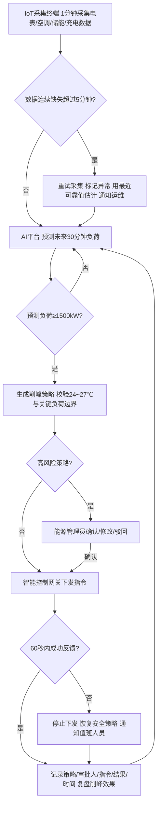

# 2026 B3 参考答案｜智慧园区能源预测与智能调度解决方案设计（40 分 · 35min）

> 交付：`参赛号/B3/答题卷.doc`（流程图用 Word/WPS 绘图）。B 模块分值最高的一题，35 分钟要写满两个任务、七个小问。

## 思考路径

| 题面信息 | 用在哪里 |
|---|---|
| 5 个现状问题（1680kW、125 万、91%、25 分钟、无追溯） | 产品设计表“解决的业务问题”列 + 验收指标 |
| 3 类产品（采集终端 / AI 平台 / 控制网关） | 设计表三行、流程图三条泳道 |
| 5 条约束 | 规则表四行 + 流程图判断节点 + 人机边界 + 留痕 |
| 建设目标百分比 | 计算验收目标值：1680×0.88 = **1478.4kW**；125×0.92 = **115 万元** |
| 8 周三阶段 | 实施计划表：关键任务 / 验收输出 / 责任人 |

**流程主线（6～8 节点）**：IoT 采集与质量校验 → AI 预测未来 30 分钟负荷 → 峰值风险判断（≥1500kW）→ 生成削峰策略并做边界校验 → 高风险策略由能源管理员确认 → 网关下发执行 → 60 秒反馈判断（失败则恢复安全策略并通知值班）→ 留痕与效果复盘。

---

# 答题卷正文

## 任务一：智能产品应用方案设计

### （1）智能产品应用设计表

| 智能产品 | 解决的业务问题 | 主要数据输入 | 系统输出或下游动作 |
|---|---|---|---|
| 能源 IoT 采集终端 | 能源数据完整率只有 91%，仪表离线后不能及时补偿或告警；数据分散 | 电表分项计量（有功功率、电量、电压电流）、楼宇自控系统空调与室温数据、储能 SOC 与充放电功率、充电桩功率与在充车辆数、设备在线状态 | 按 1 分钟频率上传带时间戳的标准化数据；数据质量标记（正常/缺失/估计值）；离线超过 5 分钟重试、标记异常、生成临时估计并通知运维；数据写入统一能源数据库 |
| AI 负荷预测与能源优化平台 | 高峰负荷靠人工观察，容易产生需量费用；空调、储能、充电缺少统一调度，电费高 | IoT 实时与历史负荷、天气预报、工作日类型、园区活动计划、分时电价、储能 SOC、室温、设备运行边界 | 未来 30 分钟负荷预测与峰值风险；推荐调度方案（空调设定温度调整、储能放电功率、充电桩限功率）及预计削峰量、风险等级；推送给能源管理员审批；策略与预测结果留痕 |
| 智能控制网关 | 从发现风险到执行调节平均 25 分钟，响应慢；指令和执行结果无追溯 | 经确认的调度策略（目标设备、参数、执行时段、审批人）、设备实时状态 | 向楼宇自控、储能 PCS、充电平台下发控制指令；60 秒内回传执行状态；未成功则停止下发、恢复安全策略、通知值班人员；指令与执行结果完整留痕 |

### （2）运行规则表

| 情况 | 判断条件 | 处理动作 |
|---|---|---|
| 能源数据连续缺失 | 某仪表数据连续缺失 **超过 5 分钟** | 采集终端自动重试采集并标记“数据异常”；重试后仍无数据，用最近可靠值形成临时估计（标记为估计值，预测时降低权重），同时通知运维人员核查；恢复后补传并校正 |
| 预测出现峰值风险 | AI 平台预测未来 30 分钟园区负荷 **≥ 1500kW** | 判定为峰值风险，生成削峰建议（优先级：储能放电 → 充电桩限功率 → 非关键区域空调温度上调），计算预计削峰量；低风险策略按预案自动执行，高风险策略推送能源管理员确认 |
| 调度方案触及运行边界 | 策略会使办公区温度超出 **24～27℃**；或涉及消防、安防、数据机房等**关键负荷**；或储能 SOC 低于下限 | 系统自动剔除违规动作，关键负荷不得列入可削减清单；温度调整限定在 27℃ 以内；剩余削峰量不足时标记为“高风险策略”，必须由能源管理员确认，必要时人工协调用能 |
| 控制指令执行失败 | 指令发出后 **60 秒内**未收到成功反馈，或设备返回异常状态 | 网关立即停止继续下发后续指令，恢复该设备的安全策略（恢复原设定值/默认运行模式），通知值班人员现场核查；记录失败原因，AI 平台重新评估剩余削峰方案 |

> 全过程留痕：策略内容、审批人、设备指令、执行结果、时间戳写入审计日志，不可修改。

### （3）多产品协同流程图

泳道：IoT 采集终端 | AI 负荷预测与能源优化平台 | 能源管理员 / 值班人员 | 智能控制网关。

## 任务二：实施与运营设计

### （1）验收指标

| 指标 | 上线前 | 建设目标 | 验收目标值 |
|---|---|---|---|
| 最大用电负荷 | 1680 kW | 降低 12% | **≤ 1478.4 kW**（1680 × 88%） |
| 月均电费 | 125 万元 | 降低 8% | **≤ 115 万元**（125 × 92%） |
| 能源数据完整率 | 91% | 达到 99% 以上 | **≥ 99%** |
| 峰值风险平均响应时间 | 25 分钟 | 缩短至 5 分钟以内 | **≤ 5 分钟** |

### （2）三阶段实施计划

| 阶段名称 | 时间周期 | 关键任务 | 验收输出 | 主要责任人 |
|---|---|---|---|---|
| 数据接入与基线建立 | 第 1～2 周 | 部署 IoT 采集终端，对接电表、楼宇自控、储能、充电平台接口；制定数据标准与质量规则；梳理关键负荷与可调负荷清单；统计近 12 个月负荷、电费、完整率、响应时间基线 | 设备接入清单与接口联调报告；数据完整率 ≥ 97% 的日报；基线报告；可调/关键负荷清单 | 项目经理、IoT 实施工程师、数据工程师、园区能源管理员 |
| 策略仿真与小范围试点 | 第 3～5 周 | 训练 30 分钟负荷预测模型并回测；用历史峰值日做策略仿真；选 1 栋办公楼 + 充电区试点，网关先“建议模式”再“半自动模式”；演练 60 秒失败回退 | 预测模型评估报告（MAPE ≤ 5%、峰值召回 ≥ 90%）；策略仿真报告；试点运行报告（削峰量、室温达标率、失败回退记录） | 人工智能训练师、算法工程师、能源管理员、楼宇自控工程师 |
| 推广上线与指标验收 | 第 6～8 周 | 全园区推广；完善审批流程与审计日志；运维和值班人员培训；连续运行并对照验收指标 | 上线报告；验收报告（四项指标达标）；运维手册与应急预案；培训记录 | 项目经理、能源管理员、运维负责人、业主方验收代表 |

### （3）人机协作边界

| 智能系统负责 | 工作人员负责 |
|---|---|
| 实时采集、数据质量校验、缺失重试与临时估计、异常告警 | 运维人员：核查离线仪表、现场维修、确认数据恢复 |
| 30 分钟负荷预测、峰值风险判定、生成削峰策略和预计效果 | 能源管理员：审批高风险策略，可修改或驳回；制定和调整运行边界、关键负荷清单 |
| 自动校验运行边界，剔除违规动作；低风险预案策略在授权范围内自动执行 | 值班人员：处理指令执行失败、设备异常和现场突发情况，必要时人工接管 |
| 下发经确认的指令、60 秒反馈监测、失败时自动恢复安全策略 | 管理层：确认削峰策略优先级与舒适度标准 |
| 全程留痕、生成日报月报和效果复盘 | 人工智能训练师：定期评估预测精度，组织模型再训练和策略优化 |

**底线**：关键负荷（消防、安防、数据机房）系统不得自动削减；高风险策略必须人工确认；任何人工改判都要留痕。

### （4）运行风险控制措施

1. **仪表离线或采集数据异常**：采集终端心跳检测，离线超过 5 分钟重试并告警；数据做范围、突变、平衡校验（分项之和与总表比对）；临时估计值打标签，预测时降低权重；关键表计双路通信或冗余采集；运维按告警等级限时到场（高等级 2 小时内）。
2. **负荷预测随季节和业态变化失准**：每天监控预测误差（MAPE、峰值漏报），连续 3 天 MAPE > 8% 或出现峰值漏报即触发再训练；换季、新商户入驻、大型活动前人工录入活动计划并做特征更新；保留人工观察作为兜底，误差大时自动切换为“建议模式”，只提示不执行。
3. **控制指令未执行或设备状态异常**：60 秒无成功反馈立即停止下发并恢复安全策略；设备状态异常自动从可调负荷清单中移除；同一设备连续失败 2 次锁定并通知检修；定期做回退演练；所有指令、反馈、恢复动作留痕，月度复盘。

---

## 交卷检查
- [ ] 设计表 3 行 × 4 列填满
- [ ] 规则表 4 行，5 分钟 / 1500kW / 24～27℃ / 关键负荷 / 60 秒全部出现
- [ ] 流程图 6～8 个主要节点，有判断、人工确认、执行反馈、留痕闭环
- [ ] 验收值算对：1478.4kW、115 万元
- [ ] 实施计划 3 阶段 × 关键任务 / 验收输出 / 责任人
- [ ] 人机边界表 + 三类风险措施
