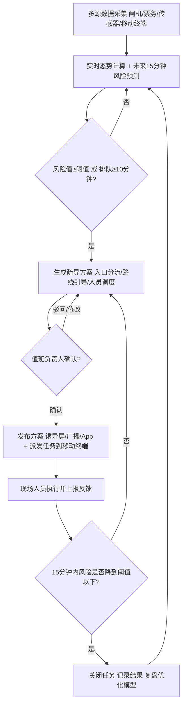

# 2026 C 参考答案｜大型场馆智能客流预测与疏导系统产品设计及实现（100 分 · 30min）

> 交付：`参赛号/C/答题卷.doc`（流程图用 Word/WPS 绘图）。30 分钟写满 3 个任务、9 个小问，必须模板化作答。

## 思考路径

| 题面信息 | 用在哪里 |
|---|---|
| 数据源：闸机、票务核验、区域客流传感器、工作人员移动终端 | 输入接口 4 行 |
| 预测未来 15 分钟风险 | `forecast_window_minutes: 15`；功能卡触发条件 |
| 生成入口分流、路线引导、人员调度建议 | F-02 功能行为；输出接口 |
| 经值班负责人确认后发布 | `manual_confirm_required: true`；状态“待确认”；流程图人工判断节点 |
| 记录执行结果 | F-03；状态“执行中→已完成”；审计内容 |

**风险指标口径（全卷统一）**：风险值 = 预测 15 分钟内区域人数 ÷ 区域安全容量；排队等待时间 = 排队人数 ÷ 闸机/通道通行速率。

---

# 答题卷正文

## 任务一：产品功能定义

**功能编号：F-01**
- 功能名称：客流态势监测
- 使用角色及触发条件：值班负责人、指挥中心调度员；场馆开放期间持续运行，每 30 秒刷新；任一区域实时或预测风险值超过阈值时高亮提醒。
- 功能行为：汇聚闸机通行、票务核验、区域传感器和移动终端上报数据，计算各入口、通道、接驳区的实时人数、密度和排队时长；结合近期客流变化和散场时间预测未来 15 分钟人数与风险值；在场馆地图上以热力图展示；检测数据缺失和异常。
- 输出结果：区域态势热力图、各区域实时人数/密度/排队时长、未来 15 分钟风险预测曲线、风险等级标签、数据质量状态。
- 验收标准：数据从采集到大屏展示的延迟 ≤ 30 秒；未来 15 分钟区域人数预测误差（MAPE）≤ 15%。

**功能编号：F-02**
- 功能名称：疏导方案生成
- 使用角色及触发条件：系统自动触发，值班负责人确认；当预测风险值 ≥ 0.8 或排队等待时长 ≥ 10 分钟时触发。
- 功能行为：识别拥堵区域及上下游通道；根据各区域剩余容量生成入口分流（引导到相邻空闲入口）、路线引导（诱导屏、广播、App 推送的路线）、人员调度（从低风险区抽调人员到指定点位）建议；估算方案实施后的风险下降；提交值班负责人确认。
- 输出结果：疏导方案单（方案编号、风险区域、分流方向、引导文案、调度人员及点位、预计效果）、待确认任务。
- 验收标准：从风险触发到生成方案 ≤ 60 秒；历史回放测试中方案执行后 15 分钟内区域风险值下降到 0.8 以下的比例 ≥ 85%。

**功能编号：F-03**
- 功能名称：处置反馈闭环
- 使用角色及触发条件：现场工作人员、值班负责人；疏导方案确认发布后自动触发。
- 功能行为：把任务派发到工作人员移动终端；工作人员接收、到岗、执行后上报（含照片和现场人数）；系统持续比对执行前后的客流数据，评估效果；超时未到岗或效果不佳时提醒值班负责人追加措施；任务结束后生成复盘记录。
- 输出结果：任务执行状态、到岗时间、执行反馈、处置前后风险对比、复盘报告。
- 验收标准：任务派发到工作人员确认接收 ≤ 2 分钟；疏导任务反馈闭环率（有执行反馈并关闭的任务 ÷ 发布任务数）≥ 98%。

## 任务二：产品方案设计

### （1）系统协同流程图



泳道：数据采集层 | 智能预测与方案系统 | 值班负责人 | 现场工作人员。

### （2）运行参数配置示例（JSON）

```json
{
  "venue_id": "STADIUM-01",
  "forecast_window_minutes": 15,
  "refresh_interval_seconds": 30,
  "risk_threshold": 0.8,
  "risk_levels": {"yellow": 0.7, "orange": 0.8, "red": 0.9},
  "queue_wait_threshold_minutes": 10,
  "manual_confirm_required": true,
  "confirm_timeout_seconds": 120,
  "task_ack_timeout_minutes": 2,
  "data_missing_alert_seconds": 60
}
```

说明：`risk_threshold` 为预测人数占区域安全容量的比例；`manual_confirm_required=true` 表示所有疏导方案必须由值班负责人确认后发布。

### （3）数据输入输出接口

| 方向 | 来源 / 去向 | 关键字段 |
|---|---|---|
| 输入 | 闸机系统 | 闸机编号、入口编号、通行方向（进/出）、通行时间、通行人数、设备状态 |
| 输入 | 票务核验系统 | 场次编号、票务区域、核验时间、已入场人数、应到人数、开散场时间 |
| 输入 | 区域客流传感器 | 区域编号、时间戳、实时人数、密度（人/㎡）、排队长度、设备在线状态 |
| 输入 | 工作人员移动终端 | 人员编号、岗位、位置、任务编号、任务状态、现场反馈（文字/照片）、上报时间 |
| 输入 | 基础配置 | 区域编号、安全容量、相邻通道关系、可调度人员名单 |
| 输出 | 指挥中心大屏 | 区域编号、实时人数、预测人数、风险值、风险等级、预警时间 |
| 输出 | 值班负责人工作台 | 方案编号、风险区域、方案内容、预计效果、确认/驳回结果、确认人、确认时间 |
| 输出 | 诱导屏 / 广播 / App | 发布编号、区域、引导文案、推荐路线、发布时间 |
| 输出 | 工作人员移动终端 | 任务编号、目标点位、任务内容、截止时间 |
| 输出 | 审计与统计库 | 风险事件、方案、确认、执行、反馈的全量记录与时间戳 |

### （4）运营统计与审计内容

1. **预测准确性统计**：每场活动统计各区域 15 分钟预测误差（MAPE）、风险预警命中率和漏报次数，用于模型优化。
2. **响应时效统计**：从风险触发 → 方案生成 → 负责人确认 → 任务接收 → 风险解除各环节耗时，统计平均值和超时次数。
3. **人工确认与操作审计**：记录每个方案的确认人、确认/驳回/修改内容、发布时间和执行反馈，可追溯“谁在什么时间做了什么决定”；同时审计数据缺失和设备异常事件。

## 任务三：产品规则配置与运行验证

### （1）客流风险分级与处置规则

| 风险等级 | 判断依据 | 系统响应 | 业务处置方式 |
|---|---|---|---|
| 一级（蓝色·正常） | 预测风险值 < 0.7，且排队等待 < 5 分钟 | 常规监测，每 30 秒刷新 | 按常规岗位值守 |
| 二级（黄色·关注） | 0.7 ≤ 风险值 < 0.8，或排队等待 5～10 分钟 | 大屏黄色提示，推送关注提醒，预生成备选方案 | 值班负责人关注，现场人员加强巡视，提前开放备用闸机 |
| 三级（橙色·预警） | 0.8 ≤ 风险值 < 0.9，或排队等待 ≥ 10 分钟 | 自动生成疏导方案，提交值班负责人确认；确认后发布诱导信息并派发任务 | 执行入口分流、路线引导，抽调人员到拥堵点位，15 分钟后评估效果 |
| 四级（红色·严重） | 风险值 ≥ 0.9，或出现逆行、滞留、人群密度 ≥ 4 人/㎡ | 红色告警，声光提醒，优先推送多套方案；通知安保负责人和场馆总值班 | 限流或暂停入场/分批散场，启动应急预案，必要时联动公安、交通部门 |

### （2）疏导任务状态流转

| 状态 | 进入条件 |
|---|---|
| ① 待确认 | 风险达到三级及以上，系统生成疏导方案并提交值班负责人 |
| ② 已发布 | 值班负责人确认（或修改后确认），系统发布诱导信息并把任务派发到移动终端 |
| ③ 执行中 | 现场工作人员在移动终端接收任务并到岗开始执行 |
| ④ 已完成（关闭） | 执行反馈已上报，且区域风险值连续 5 分钟低于 0.8；或值班负责人人工关闭。被驳回的方案进入“已取消”，效果不佳则重新生成方案 |

流转：待确认 → 已发布 → 执行中 → 已完成；异常分支：待确认 →（驳回）→ 已取消；执行中 →（15 分钟未缓解）→ 重新生成方案。

### （3）三类运行场景验证

| 场景 | 业务条件 | 系统与工作人员协同处理过程 | 最终记录结果 |
|---|---|---|---|
| 日常客流 | 平日开放或活动中段，各区域风险值 < 0.7，排队 < 5 分钟 | 系统持续监测、预测；不生成疏导方案；工作人员正常值守；系统生成时段客流报表 | 各区域客流曲线、预测误差、设备在线率；无预警事件 |
| 高峰风险 | 演唱会散场，北门通道预测 15 分钟后风险值 0.86、排队 12 分钟 | 系统判定三级预警，60 秒内生成方案：引导部分观众走东门、诱导屏和广播发布路线、从南区调 6 名人员到北门；值班负责人确认后发布；工作人员 2 分钟内接收、到岗执行并上报；系统 15 分钟后评估风险降至 0.72，任务关闭 | 风险事件编号、方案内容、确认人与时间、任务执行与反馈、处置前后风险值、总处置时长 |
| 数据异常 | 某区域传感器离线超过 60 秒或数据突变（人数瞬间归零） | 系统标记该区域数据异常，改用闸机进出差值和相邻区域数据估算人数，并在大屏标注“估计值”；告警通知运维核查；该区域风险判断降级为人工确认，值班负责人安排人员现场目测上报 | 异常设备编号、开始与恢复时间、估算方式、现场上报记录、运维处理结果 |

---

## 交卷检查
- [ ] 3 张功能卡，每张 5 项齐全，验收标准带数字
- [ ] 流程图 6～8 个主要节点，有“负责人确认”判断和“效果评估”回路
- [ ] JSON 含 4 个指定字段，值与风险分级一致
- [ ] 输入 4 类来源 + 输出去向，均有关键字段
- [ ] 3 项统计审计；≥3 级风险分级；4 个状态 + 进入条件；3 类场景
